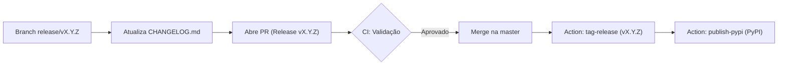

# Processo de Lançamento (Release Process)

Este documento descreve o fluxo de publicação de novas versões do pacote `ds-contest-tools`.

O processo de lançamento de uma nova versão da aplicação é automatizado usando o `setuptools_scm` para o versionamento dinâmico baseado em Tags do Git, aliado ao GitHub Actions para a Integração e Entrega Contínuas (CI/CD).

Para contribuições do dia a dia que não envolvem lançamento de versão, consulte as [Diretrizes para Pull Requests](pull-requests.md).

> [!IMPORTANT]
> **A validação de novas versões ocorre conferindo o título do Pull Request e o arquivo `CHANGELOG.md`.** Você não precisa (e não deve) alterar a versão manualmente em arquivos `.py` ou no `pyproject.toml`.

---

## Visão Geral do Fluxo



---

## Como lançar uma nova versão

Para publicar uma nova versão oficial (ex: `1.2.0`), siga estes passos:

### Passo 1: Atualizar o CHANGELOG.md

Crie uma nova branch a partir da `master` (ex: `release/v1.2.0`).
Abra o arquivo `CHANGELOG.md` e copie o template disponível nos comentários HTML do próprio arquivo.
Cole logo após o bloco de comentário e preencha com as alterações da versão.

**Exemplo:**
```markdown
## [1.2.0] - 29/08/2026

### Adicionado
- Nova funcionalidade incrível.

### Corrigido
- Correção do bug na geração de PDFs.
```

### Passo 2: Abrir um Pull Request

Faça o commit dessa alteração (ex: `git commit -m "chore: release v1.2.0"`) e abra um Pull Request para a branch `master`.

> [!IMPORTANT]
> **Padrões de Nomenclatura do PR**
>
> A esteira é inteligente, mas precisa que o **título** do Pull Request indique claramente que se trata de uma release para poder extrair a versão. Os formatos aceitos abrangem várias convenções da comunidade (com ou sem 'v' maiúsculo/minúsculo):
>
> **Família "Release":**
>
> * `Release v1.2.0` (Recomendado)
> * `Release 1.2.0`
> * `release v1.2.0`
> * `release 1.2.0`
> * `Release: 1.2.0`
> * `release: 1.2.0`
>
> **Família "Conventional Commits":**
>
> * `chore(release): 1.2.0`
> * `chore(release): v1.2.0`
>
> **Versão Direta:**
>
> * `v1.2.0`
> * `1.2.0`

### Passo 3: Validação Automática (CI)

Neste momento, a nossa esteira (GitHub Actions) entrará em ação:

1. A esteira extrairá a versão (`1.2.0`) do título do seu PR.
2. A esteira fará uma verificação cruzada para garantir que o cabeçalho `## [1.2.0]` existe de fato dentro do `CHANGELOG.md`.
3. Será feito um build de testes (`dry-run`) para garantir que os pacotes compilam corretamente.
4. Se o título estiver errado ou o CHANGELOG não estiver preenchido, a esteira bloqueará o merge.

### Passo 4: Aprovação e Merge

Um mantenedor autorizado (Code Owner) deve revisar e aprovar o Pull Request.
Após a aprovação oficial, faça o **Merge** do Pull Request na branch `master`.

### Passo 5: A automação faz o resto! (CD)

Assim que o merge for concluído, duas esteiras são disparadas em sequência:

1. **Criação da Tag:** A esteira `tag-release` detecta que um PR com título `Release vX.Y.Z` foi mergeado, cria automaticamente a tag `v1.2.0` no repositório e aciona o workflow de publicação.

2. **Build e Deploy:** A esteira `publish-pypi` é executada sobre a tag criada e:
   - Gera os artefatos (`.whl` e `.tar.gz`) usando o `setuptools_scm` com a versão da tag.
   - Valida os artefatos com `twine check`.
   - Publica automaticamente no **PyPI** oficial (via Trusted Publishing OIDC).

Pronto! Em alguns minutos a nova versão estará disponível para todo o mundo via `pip install ds-contest-tools`.

---

## Contingência e Execução Manual

Se alguma etapa da esteira automática falhar após o merge na `master`, utilize o procedimento correspondente ao ponto de falha:

### 1. A tag já foi criada, mas o `publish-pypi` falhou

Se o erro foi pontual (ex.: instabilidade temporária do PyPI ou ajuste posterior nas permissões de *Trusted Publishing*), é possível reexecutar apenas a publicação mantendo o uso de OIDC:

* **Pela interface do GitHub (UI):**
  1. Acesse a aba **Actions** no GitHub e abra o workflow **Publish to PyPI** (`publish-pypi.yml`).
  2. Clique em **Run workflow**.
  3. No seletor **Use workflow from**, troque de `master` para a aba **Tags** e selecione a tag desejada (ex.: `v1.2.0`).
  4. Clique em **Run workflow**.

  > [!NOTE]
  > O workflow valida se a referência selecionada é uma tag no formato `vX.Y.Z`. Executar a partir da branch `master` é bloqueado propositalmente para evitar publicação acidental de versões `.dev`.

* **Pelo GitHub CLI (`gh`):**
  ```bash
  gh workflow run publish-pypi.yml --ref refs/tags/v1.2.0
  ```

*(Se o erro tiver sido transitório em uma execução já existente, também é possível clicar em **Re-run failed jobs** diretamente na página da execução que falhou.)*

### 2. A tag ainda não foi criada após o merge

Acesse **Actions** $\rightarrow$ **Create Release Tag** (`tag-release.yml`) $\rightarrow$ **Run workflow**, informe a versão no campo `version` (ex.: `1.2.0` ou `v1.2.0`) na branch `master` e execute. O workflow criará a tag e disparará o `publish-pypi.yml` automaticamente.

### 3. Publicação local via `twine` (indisponibilidade do GitHub Actions)

Como último recurso, um mantenedor com API Token no PyPI pode gerar e enviar o pacote localmente a partir da tag exata e com o diretório de trabalho limpo (para que o `setuptools_scm` gere a versão `X.Y.Z` sem sufixo `.dev` ou `.dirty`):

```bash
git fetch --tags
git checkout v1.2.0
git status

rm -rf dist/ build/
python -m build
twine check dist/*
twine upload dist/*
```

> [!CAUTION]
> **Quando a falha exigir correção no código ou nos workflows:**
> * **Versão ainda NÃO publicada no PyPI:** após corrigir o problema na `master`, remova a tag antiga (`git push origin :refs/tags/vX.Y.Z`) antes de recriá-la via **Create Release Tag**, ou avance para uma nova versão patch (`vX.Y.Z+1`).
> * **Versão JÁ publicada no PyPI:** o PyPI não permite sobrescrever artefatos existentes; corrija o problema e publique uma nova versão patch (`vX.Y.Z+1`).

---

## Regras importantes

* O formato da versão no CHANGELOG deve ser estritamente `[X.Y.Z]`.
* O título do Pull Request de release deve seguir um dos padrões aceitos (ex: `Release vX.Y.Z`).
* As aprovações de Pull Request na `master` são restritas aos responsáveis configurados no `CODEOWNERS`.
* **Não crie tags manualmente no fluxo normal.** A esteira `tag-release` é responsável por isso após o merge (utilize a seção de contingência apenas em caso de falha na automação).
